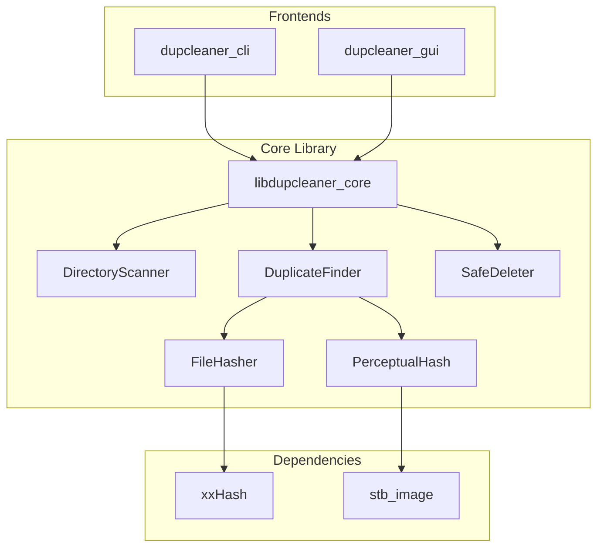
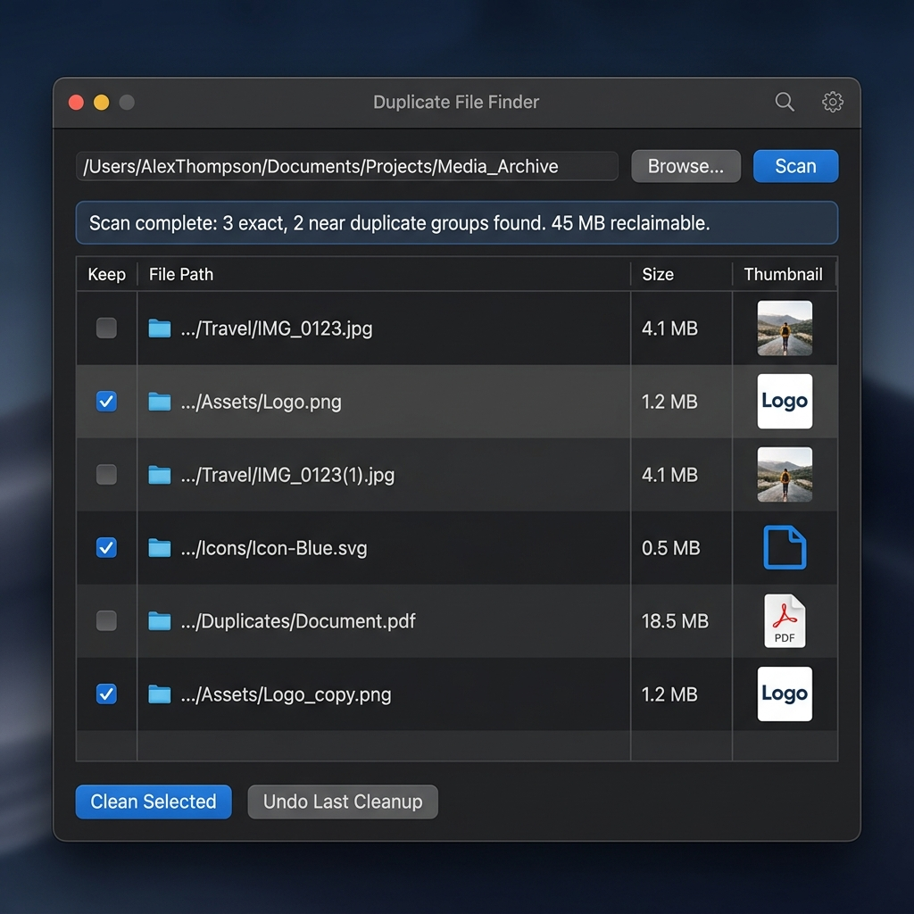

# DupCleaner

[](https://github.com/hamzamir1618/DupCleaner/actions/workflows/ci.yml)
[](https://github.com/hamzamir1618/DupCleaner/actions/workflows/release.yml)

**DupCleaner** is a blazing-fast, cross-platform utility for finding and safely managing exact duplicate files and near-duplicate images (e.g., resized, slightly cropped, compressed photos). It scans your drives, reports exactly how much space is being wasted, and allows you to safely clean up storage using an intuitive Graphical User Interface (GUI) or a powerful Command Line Interface (CLI).

## Features

- [x] **Recursive Directory Scanning:** Quickly scans deep folder trees while gracefully skipping unreadable or broken files.
- [x] **Exact Duplicate Detection:** Groups identical files securely using size filtering followed by high-throughput `xxHash` byte verification.
- [x] **Near-Duplicate Image Detection:** Identifies slightly altered images (like Instagram crops or JPEG compressions) using Perceptual Hashing (dHash).
- [x] **Reclaimable Space Reporting:** Accurately calculates exactly how many bytes you'll save before you delete anything.
- [x] **Safe Deletion:** Moves duplicates to a local `.dupcleaner_trash` directory rather than permanently destroying them immediately.
- [x] **Undo Capabilities & Trash Management:** Instantly reverse the last cleanup operation, or permanently empty the trash bin to free up disk space.
- [x] **CLI Frontend:** Scriptable interface with JSON output, dry-runs, and interactive review modes.
- [x] **GUI Frontend:** A modern, beautiful `Dear ImGui` desktop application featuring FontAwesome iconography, a visual Grid/Card layout for image thumbnails, and point-and-click cleanup.
- [x] **Multi-threaded Performance:** Leverages your entire CPU to parallelize disk reads and image decoding.

---

## Architecture

DupCleaner is built in C++17. It isolates its core logic into `libdupcleaner_core` which is consumed independently by both the CLI and GUI frontends.



---

## Safety Model

Data loss is our biggest enemy. DupCleaner implements a "Trash-by-Default" safety model:
1. When you "clean" files, they are **not** permanently deleted. Instead, they are moved to a hidden directory (`.dupcleaner_trash`) located inside the folder you just scanned.
2. An automatic manifest (`.json`) tracks the exact original absolute pathways of those files.
3. If you realize you deleted the wrong files, you can simply run the `undo` command (or click "Undo Last Cleanup" in the GUI) to restore them perfectly.
4. When you're completely sure, you can click **Empty Trash** to securely free up the disk space.

*Note: You can intentionally bypass this safeguard and invoke irreversible deletion using the `--permanent` flag in the CLI, or by unchecking the "Move to Trash (Undoable)" toggle inside the GUI confirmation prompt.*

---

## Performance Notes

DupCleaner is engineered for speed, avoiding disk thrashing and redundant hash calculations:
- **Bucket-First Grouping:** Files are only hashed if they have the exact same file size. 
- **Chunked File Reading:** Huge multi-gigabyte ISOs or video files are streamed in 64KB chunks to prevent memory bloat, breaking out early the moment two chunks diverge.
- **Multithreading:** The `DuplicateFinder` uses a bounded `ThreadPool`. Hashing 100+ large files or decoding dozens of near-duplicate images utilizes 100% of available CPU cores simultaneously.
- **Throughput:** In benchmark testing on consumer NVMe drives, exact hashing using `xxHash` successfully processed over 14,000 files in ~190ms.

---

## GUI Usage Guide

For an interactive, visual experience, launch the graphical application:

```bash
dupcleaner_gui
```



1. **Target Directory:** Launch `dupcleaner_gui`. At the top, click **Browse...** to open a native file picker or type the directory manually.
2. **Scan:** Click **Scan**. The interface will display a live progress status bar showing the number of files and bytes scanned in real-time.
3. **Review:** Once completed, results elegantly populate into a wrapping **Grid Layout** under "Exact Duplicates" and "Near Duplicates" tabs. Inline thumbnails are displayed for image files. The total space you are about to save is displayed dynamically at the bottom.
4. **Cleanup:** Check or uncheck the checkboxes to retain or discard files. Click **Clean Selected** on the bottom action bar. A confirmation modal will appear allowing you to move them to the `.dupcleaner_trash` bin or permanently delete them.
5. **Trash Management:** Use the **Undo Last Cleanup** button to revert your last bulk deletion, or click **Empty Trash** to permanently clear the bin.

---

## CLI Reference

The CLI binary (`dupcleaner_cli`) is ideal for power users and automation scripts.

### 1. `scan` - Discovering Duplicates
Finds duplicate files and optionally outputs JSON format.

**Command Usage:**
```bash
dupcleaner_cli scan [OPTIONS] path
```

**Options:**
- `--min-size UINT` : Skip files smaller than this (in bytes).
- `--json` : Output report as JSON for programmatic integration.
- `--verbose` : Print skipped paths and detailed stats.
- `--include-near-duplicates` : Also scan for near-duplicate images using perceptual hashing.
- `--similarity-threshold INT` : Hamming distance threshold for near-duplicates (default: 10).
- `--hash-threads INT` : Number of threads to use for hashing (default: min(hardware_concurrency, 4)).
- `--exclude PATTERN` : Exclude paths matching glob pattern (can be specified multiple times).
- `--no-default-excludes` : Disable built-in system directory exclusions.

> [!WARNING]
> By default, `dupcleaner` avoids traversing critical OS directories (e.g. `Windows\WinSxS`, `/System`, `/proc`). Modifying these files can severely break your OS. Using `--no-default-excludes` on a root drive scan is highly discouraged unless you fully understand the risks.

**Performance Note on `--hash-threads`:**
The fingerprinting phase is typically IO-bound (limited by disk read speeds) rather than CPU-bound. 
- On fast SSDs/NVMe drives, you may see better performance by increasing this value (e.g., `--hash-threads 8` or `--hash-threads 16`).
- On traditional spinning hard drives (HDDs), high concurrency can cause disk thrashing and degrade performance. A lower value (e.g., `--hash-threads 1` or `--hash-threads 2`) is recommended to ensure sequential reads.
The default value is conservatively set to `min(hardware_concurrency, 4)` as a safe starting point.

**Example Output:**
```bash
$ dupcleaner_cli scan ./my_photos --min-size 1024
Found 1 exact duplicate groups:

Group 1 (Size: 1048576 bytes, Wasted: 1048576 bytes):
  - C:\my_photos\vacation.jpg
  - C:\my_photos\backup\vacation_copy.jpg

Total wasted space: 1048576 bytes.
```

### 2. `clean` - Removing Duplicates
Analyzes and automatically or interactively deletes duplicates.

**Command Usage:**
```bash
dupcleaner_cli clean [OPTIONS] path
```

**Options:**
- `--min-size UINT` : Skip files smaller than this (in bytes).
- `--strategy TEXT` : Deletion strategy: `oldest`, `newest`, `alpha-first` (default: keeps oldest).
- `--trash` : Move files to `.dupcleaner_trash` (default).
- `--permanent` : Permanently delete files (irreversible!).
- `--dry-run` : Print the deletion plan without modifying the filesystem.
- `--yes` : Skip the `[y/N]` interactive confirmation prompt.
- `--interactive` : Interactively review each duplicate group, allowing you to accept the system suggestion, skip the group, or pick a specific file to keep.
- `--include-near-duplicates` / `--similarity-threshold INT` : Enable cleaning of near-duplicate images.

**Example (Interactive Review):**
```bash
$ dupcleaner_cli clean ./my_photos --interactive
--- Exact Duplicate Group 1 of 1 ---
Reviewing Group:
  [1] C:\my_photos\vacation.jpg (1048576 bytes) (*Suggested*)
  [2] C:\my_photos\backup\vacation_copy.jpg (1048576 bytes)
Action (a=accept suggestion, s=skip group, k<N>=keep file N): k2
```

### 3. `undo` - Restoring Trashed Files
Instantly restores the last batch of files sent to the `.dupcleaner_trash`.

**Command Usage:**
```bash
dupcleaner_cli undo [OPTIONS] path
```

## Installation

Pre-built packages are generated automatically via GitHub Actions for Windows, macOS, and Linux.

1. Navigate to the **Actions** tab of this repository.
2. Select the **Release Packages** workflow on the left sidebar.
3. Click on the latest successful workflow run.
4. Download the corresponding artifact for your OS from the **Artifacts** section (`DupCleaner-Windows.zip`, `DupCleaner-macOS.tar.gz`, or `DupCleaner-Linux.tar.gz`).
5. Extract the archive and run the included `dupcleaner_gui` or `dupcleaner_cli` executable.

---

## Build Instructions

### Prerequisites
- **Windows / macOS:** Built-in graphics libraries are sufficient.
- **Linux (Ubuntu/Debian):** Requires OpenGL, X11, and Wayland development headers for the GUI.
  ```bash
  sudo apt-get update
  sudo apt-get install build-essential cmake libgl1-mesa-dev xorg-dev libx11-dev libxcursor-dev libxi-dev libxinerama-dev libxrandr-dev libwayland-dev libxkbcommon-dev wayland-protocols
  ```

### Building the Project

The project uses CMake to fetch all third-party dependencies (`xxHash`, `stb_image`, `GoogleTest`, `CLI11`, `Dear ImGui`, `GLFW`) automatically.

```bash
# 1. Clone the repository
git clone https://github.com/hamzamir1618/DupCleaner.git
cd DupCleaner

# 2. Configure the build
cmake -S . -B build -DCMAKE_BUILD_TYPE=Release

# 3. Compile the binaries (CLI and GUI)
cmake --build build --config Release

# 4. Run the automated test suite
ctest --test-dir build --output-on-failure
```

*Note: You can omit building the GUI or Tests by passing `-DDUPCLEANER_BUILD_GUI=OFF` or `-DDUPCLEANER_BUILD_TESTS=OFF` during the configuration step.*

---

## Known Limitations
- **No Drive Overview Dashboard:** There is no specific visualization mapping disk utilization before running a scan.
- **Cancel Scanning:** Single-threaded scan cancellation is not yet supported. You must wait for a scan to finish before launching a new one in the GUI.

---

## Contributing
Please read our [Contributing Guidelines](CONTRIBUTING.md) before submitting Pull Requests to ensure your tests, documentation, and CI workflows meet project conventions.
